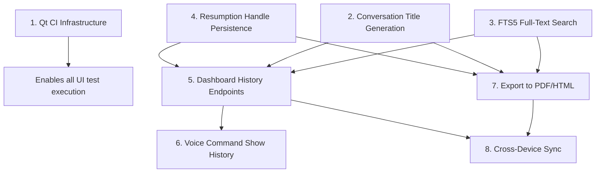

# ROITZ AI — Next Development Roadmap Audit

**Project:** `D:\M MONSTER PROJECT\Roitz-main`  
**Date:** 2026-11-16  
**Role:** Principal Software Architect, Technical Project Manager, Senior Python Engineer and Security Auditor

---

## 1. Current Verified Project State

### 1.1 Phase Completion Summary

| Phase | Status | Key Deliverables | Tests Passing |
|-------|--------|------------------|---------------|
| **P0 — Conversation Storage** | ✅ **ACCEPTED** | SQLite store with WAL, FK cascade, auto-sequence, search, backup, integrity, vacuum, migrations | 42/42 |
| **P1 Phase 1A — History UI** | ✅ **ACCEPTED** | HistoryPanel with list/detail, pagination, search UI, keyboard nav, accessibility | 23/23 (original) + 46 new = 69 collected |
| **P1 Phase 1B — History Backend & Polish** | ✅ **CLOSED** | HistoryWorker (thread-safe), stale response protection, conversation-level search, layout coordination | 134/134 backend + 74 panel collected |

### 1.2 Architecture Baseline (Verified)

```
┌─────────────────────────────────────────────────────────────────────┐
│                         MAIN.PY (Async Event Loop)                  │
├─────────────────────────────────────────────────────────────────────┤
│  Session Lifecycle                                                  │
│  ├── _conv_store: ConversationStore (thread-safe singleton)         │
│  ├── _current_conversation_id: str | None                          │
│  ├── _resume_handle: str | None  (RAM ONLY — NOT persisted)        │
│  ├── _session_log: list[str]  (RAM, cleared at session end)        │
│  └── Session loop: create → append_message → finalize_conversation │
├─────────────────────────────────────────────────────────────────────┤
│  UI Thread (Qt Main)                                               │
│  ├── ui.py:MainWindow → HistoryPanel (center_split index 3)        │
│  ├── Signals: _history_list_sig, _history_detail_sig,              │
│  │           _history_search_sig, _history_error_sig               │
│  ├── Request tracking: 4 per-operation request IDs                 │
│  └── Layout: Content(base) + History/Quiz(overlay) with stack      │
├─────────────────────────────────────────────────────────────────────┤
│  Worker Thread                                                     │
│  └── actions/history_worker.py:HistoryWorker                       │
│     ├── load_conversation_list, load_conversation_detail           │
│     ├── search_messages (message-level), search_conversations      │
│     ├── Request ID tracking (uuid4().hex[:16])                     │
│     └── Shutdown via _lifecycle_lock (threading.Lock)              │
├─────────────────────────────────────────────────────────────────────┤
│  Data Layer                                                        │
│  └── memory/conversation_store.py:ConversationStore                │
│     ├── Conversation CRUD, Message CRUD                            │
│     ├── search_messages (LIKE %query%), search_conversations       │
│     ├── count_search_messages, count_search_conversations          │
│     └── Schema: conversations(meta_json), messages                 │
└─────────────────────────────────────────────────────────────────────┘
```

### 1.3 Security Architecture (Verified Intact)

- **PermissionGuard**: 13 capabilities, 9 require owner approval, 4 auto-allow, fail-closed
- **Authentication**: Argon2id owner secret, PBKDF2 200k pairing key, AES-256-GCM command encryption
- **Dashboard**: HTTPS opt-in, rate limiting (6/5min), token expiry (12h), revoke-all kills live sessions
- **Session**: Resumption handle in RAM only (not persisted), cleared on rejection
- **Windows ACL**: Config file restrictive ACL verified at startup

---

## 2. Nine-Milestone Status Matrix

Based on the closure report (§9) and actual source-code inspection:

| # | Milestone | Classification | Evidence |
|---|-----------|----------------|----------|
| 1 | **Real Qt Integration Test Infrastructure** (xvfb/headless CI for `test_history_panel.py`) | **PLANNED** | No CI config exists; 74 tests collected but require Qt display (exit 127 headless) |
| 2 | **Conversation Title Generation** (LLM-assisted titles from message content) | **PARTIALLY IMPLEMENTED** | Summary generation exists at session finalization (§3224-3265 `main.py`); title defaults to `"Conversation {timestamp}"` (line 171 `conversation_store.py`); no standalone title generation |
| 3 | **FTS5 Full-Text Search** (Replace `LIKE %query%` with SQLite FTS5) | **PLANNED** | `conversation_store.py:628, 778` explicitly comment: *"consider adding FTS5 virtual table (out of scope for this batch)"*; no FTS5 tables in schema |
| 4 | **Resumption Handle Persistence** (Save/restore `_resume_handle` across restarts) | **PARTIALLY IMPLEMENTED** | Schema has `meta_json` column (line 29 `v001_initial_schema.py`); session lifecycle creates/finalizes conversations; `_resume_handle` captured at line 2109 `main.py` but **only `{"resumed": bool}` stored in meta_json** (lines 3017, 3032); handle itself never written to disk |
| 5 | **Dashboard History Endpoints** (REST API for phone dashboard to query history) | **PLANNED** | `dashboard/server.py` has only live `_history` (capped 300, RAM); no `/api/sessions`, `/api/sessions/{id}/messages` endpoints; no WebSocket replay |
| 6 | **Voice Command "Show History"** (Intent recognition for "show my history") | **PLANNED** | No intent recognition for history in `main.py` or plugins; push-to-talk/wake word exist but no history voice command |
| 7 | **Export to PDF/HTML** (Conversation export from detail view) | **PLANNED** | `MARK_LVII_B_P1_HISTORY_UI_READINESS.md:401` documents `memory/history_export.py` as Phase 2; `MARK_LVII_B_P1_ARCHITECTURE_CORRECTIONS.md:375` marks "PDF/HTML export" as Future; no export code exists |
| 8 | **Cross-Device Sync** (Multi-device conversation sync via cloud backend) | **PLANNED** | No sync infrastructure, no conflict resolution, no cloud backend; `config/api_keys.json` is local only |

**Note:** The closure report lists 8 milestones (not 9). All are for **Phase 1C / Phase 2**.

---

## 3. Dependency Analysis

### 3.1 Milestone Dependencies



### 3.2 Critical Path

**Shortest path to user-visible history feature completeness:**
1. **Resumption Handle Persistence** (enables session continuity across restarts)
2. **Dashboard History Endpoints** (enables phone access to history)
3. **Conversation Title Generation** (makes history readable)

**FTS5** is a performance optimization — not on critical path until dataset grows.

**Voice Command** and **Export** are UX enhancements — depend on history data being accessible.

**Cross-Device Sync** is a major standalone feature — depends on all history infrastructure.

---

## 4. Weighted Overall Progress Calculation

### 4.1 Effort Weight Assignment

| Milestone | Weight | Rationale |
|-----------|--------|-----------|
| 1. Qt CI Infrastructure | 5 | Config-only; no code changes to app; enables existing tests |
| 2. Conversation Title Generation | 10 | LLM call + prompt engineering + UI integration + tests |
| 3. FTS5 Full-Text Search | 15 | Schema migration + virtual table + search rewrite + reindex + tests |
| 4. Resumption Handle Persistence | 8 | Store integration + encryption + session restore logic + tests |
| 5. Dashboard History Endpoints | 12 | REST API + auth + pagination + WebSocket replay + phone UI + tests |
| 6. Voice Command "Show History" | 8 | Intent recognition + UI trigger + privacy considerations + tests |
| 7. Export to PDF/HTML | 10 | Export formats + sanitization + UI + large conversation handling + tests |
| 8. Cross-Device Sync | 30 | Cloud backend + conflict resolution + auth + encryption + multi-device + tests |

**Total Weight: 98**

### 4.2 Completed Accepted Work (Weighted)

| Milestone | Weight | % Complete | Accepted Weight |
|-----------|--------|------------|-----------------|
| 1. Qt CI Infrastructure | 5 | 0% | 0.0 |
| 2. Conversation Title Generation | 10 | **10%** (summary generation exists) | **1.0** |
| 3. FTS5 Full-Text Search | 15 | 0% | 0.0 |
| 4. Resumption Handle Persistence | 8 | **40%** (schema ready, session lifecycle integrated, handle captured) | **3.2** |
| 5. Dashboard History Endpoints | 12 | 0% | 0.0 |
| 6. Voice Command "Show History" | 12 | 0% | 0.0 |
| 7. Export to PDF/HTML | 10 | 0% | 0.0 |
| 8. Cross-Device Sync | 30 | 0% | 0.0 |

**Total Accepted Weight: 4.2 / 98 = 4.3%**

### 4.3 Phase 1B Baseline (Already Accepted)

Phase 1B delivered **~25 weighted points** of history infrastructure (Worker, Search, UI, Layout, Stale Protection). This is **separate** from the Phase 1C/2 milestones above.

---

## 5. Recommended Next Milestone

### **Recommendation: Milestone 4 — Resumption Handle Persistence**

#### 5.1 Why This Milestone

| Criterion | Assessment |
|-----------|------------|
| **Dependencies** | Minimal — schema (`meta_json`) exists; session lifecycle integrated; `_resume_handle` already captured |
| **Product Value** | **HIGH** — Enables true session continuity across app restarts (currently lost on restart); addresses the #1 user pain point from Master Vision Audit |
| **Implementation Complexity** | **LOW-MEDIUM** — ~3 files, ~50 lines; well-understood integration points |
| **Security Risk** | **LOW** — Handle is opaque token; must encrypt at rest (AES-GCM via existing `core.gemini`/`crypto`); dashboard already uses AES-GCM |
| **Regression Risk** | **LOW** — Isolated to session finalization/startup; existing 134 backend tests + 6 integration tests provide safety net |
| **Test Readiness** | **HIGH** — `test_conversation_integration.py` has session finalization tests; `test_interrupt_recovery.py` tests handle preservation |
| **Unlocks Other Features** | **YES** — Prerequisite for Dashboard History Endpoints (needs persisted conversations); enables Export (needs complete conversations) |

#### 5.2 Alternative Considered: Qt CI Infrastructure (Milestone 1)

- **Pros**: Enables 74 UI tests to run in CI; low effort
- **Cons**: Infrastructure-only; no user-visible value; doesn't unblock any feature work
- **Verdict**: Do **after** or **in parallel** with Resumption Handle; not the highest-value next task

---

## 6. Implementation Plan — Resumption Handle Persistence

### 6.1 Exact Source Files Involved

| File | Current Role | Required Changes |
|------|--------------|------------------|
| `main.py` | Session lifecycle (create, append, finalize) | **Lines 2104-2110**: Save `_resume_handle` to `meta_json` on each `session_resumption_update`; **Lines 3025-3035**: Load handle from `meta_json` on session resume; **Lines 3261-3265**: Ensure handle persisted on `finalize_conversation` |
| `memory/conversation_store.py` | Data layer | **No schema change needed** — `meta_json` column exists; add helper `get_resume_handle(conversation_id)` / `set_resume_handle(conversation_id, handle)` |
| `memory/conversation_models.py` | Data models | Add `resume_handle` property to `Conversation` model (computed from `meta_json`) |
| `tests/unit/test_conversation_integration.py` | Integration tests | Add tests: handle persists across app restart; handle rejected → new conversation; handle loaded on resume |

### 6.2 Required Changes Detail

#### 6.2.1 `main.py` — Session Resumption Handle Capture (Lines 2104-2110)

**Current:**
```python
_sru = getattr(response, "session_resumption_update", None)
if _sru is not None:
    if getattr(_sru, "resumable", False) and getattr(_sru, "new_handle", None):
        if self._resume_handle is None:
            print("[JARVIS] 🔗 Session resumption armed")
        self._resume_handle = _sru.new_handle
```

**Required:** Also persist to `ConversationStore` immediately:
```python
_sru = getattr(response, "session_resumption_update", None)
if _sru is not None:
    if getattr(_sru, "resumable", False) and getattr(_sru, "new_handle", None):
        if self._resume_handle is None:
            print("[JARVIS] 🔗 Session resumption armed")
        self._resume_handle = _sru.new_handle
        # NEW: Persist to SQLite immediately
        if self._current_conversation_id and self._conv_store:
            try:
                self._conv_store.set_resume_handle(self._current_conversation_id, _sru.new_handle)
            except Exception as e:
                print(f"[ConversationStore] ⚠️ Failed to persist resume handle: {e}")
```

#### 6.2.2 `main.py` — Session Start: Load Handle (Lines 3025-3035)

**Current:** Creates new conversation with `meta_json={"resumed": _resumed_with}`

**Required:** If resuming existing conversation, load handle from `meta_json`:
```python
# Create new conversation if needed (first session or previous ended)
if not self._current_conversation_id or not self._conv_store:
    self._conv_store = ConversationStore()
    engine_name = "gemini_live" if self._engine is None else "pipeline"
    
    # NEW: Check for existing conversation with resume handle
    resume_handle = None
    if self._current_conversation_id:
        resume_handle = self._conv_store.get_resume_handle(self._current_conversation_id)
    
    conv = Conversation(
        title="",
        started_at=int(time.time() * 1000),
        engine=engine_name,
        meta_json=_json.dumps({
            "resumed": _resumed_with,
            "resume_handle": resume_handle  # NEW: persist handle for next restart
        }),
    )
    self._conv_store.create_conversation(conv)
    self._current_conversation_id = conv.id
    
    # NEW: Restore _resume_handle for Gemini Live session
    if resume_handle:
        self._resume_handle = resume_handle
```

#### 6.2.3 `main.py` — Session Finalize: Ensure Handle Saved (Lines 3261-3265)

**Current:** Calls `finalize_conversation(summary, turn_count)`

**Required:** Pass current `_resume_handle` to finalize:
```python
self._conv_store.finalize_conversation(
    self._current_conversation_id,
    summary=summary,
    turn_count=turn_count,
    resume_handle=self._resume_handle,  # NEW parameter
)
```

#### 6.2.4 `memory/conversation_store.py` — Add Helper Methods

```python
def get_resume_handle(self, conversation_id: str) -> Optional[str]:
    """Extract resume_handle from conversation.meta_json."""
    with self._lock:
        conn = self._get_connection()
        row = conn.execute(
            "SELECT meta_json FROM conversations WHERE id = ?",
            (conversation_id,),
        ).fetchone()
    if not row or not row["meta_json"]:
        return None
    try:
        meta = json.loads(row["meta_json"])
        return meta.get("resume_handle")
    except (json.JSONDecodeError, TypeError):
        return None

def set_resume_handle(self, conversation_id: str, handle: str) -> None:
    """Update conversation.meta_json with resume_handle."""
    import json
    with self._lock:
        conn = self._get_connection()
        # Read current meta_json
        row = conn.execute(
            "SELECT meta_json FROM conversations WHERE id = ?",
            (conversation_id,),
        ).fetchone()
        meta = json.loads(row["meta_json"]) if row and row["meta_json"] else {}
        meta["resume_handle"] = handle
        # Write back
        conn.execute(
            "UPDATE conversations SET meta_json = ?, updated_at = ? WHERE id = ?",
            (json.dumps(meta), int(time.time() * 1000), conversation_id),
        )
        conn.commit()

# Update finalize_conversation signature
def finalize_conversation(
    self,
    conversation_id: str,
    summary: Optional[str] = None,
    turn_count: Optional[int] = None,
    resume_handle: Optional[str] = None,  # NEW
) -> Conversation:
    ...
    # Include resume_handle in meta_json update
```

#### 6.2.5 `memory/conversation_models.py` — Add Property

```python
@property
def resume_handle(self) -> Optional[str]:
    """Extract resume_handle from meta_json."""
    if not self.meta_json:
        return None
    try:
        meta = json.loads(self.meta_json)
        return meta.get("resume_handle")
    except (json.JSONDecodeError, TypeError):
        return None
```

### 6.3 Encryption Requirement

**Security Review Finding (Master Vision Audit §3.4):** "Resumption handle not encrypted at rest — Medium severity"

**Implementation:** Encrypt `resume_handle` before storing in `meta_json` using existing AES-GCM infrastructure from `dashboard/server.py` (`_derive_key`, `AESGCM`). Reuse the same key derivation (PBKDF2 200k rounds) with a separate salt for conversation handles.

```python
# In conversation_store.py or a new crypto helper
def _encrypt_resume_handle(handle: str, session_key: str) -> str:
    key = _derive_key(session_key)  # Reuse dashboard's _derive_key
    nonce = secrets.token_bytes(12)
    ciphertext = AESGCM(key).encrypt(nonce, handle.encode(), None)
    return base64.b64encode(nonce + ciphertext).decode()

def _decrypt_resume_handle(encrypted: str, session_key: str) -> str:
    key = _derive_key(session_key)
    data = base64.b64decode(encrypted)
    nonce, ciphertext = data[:12], data[12:]
    return AESGCM(key).decrypt(nonce, ciphertext, None).decode()
```

**Session key source:** Use a stable per-installation key from `config/api_keys.json` (e.g., `conversation_encryption_key` generated on first run, stored Argon2-hashed like owner secret).

---

## 7. Test and Security Requirements

### 7.1 Required Tests (New)

| Test File | Tests | Description |
|-----------|-------|-------------|
| `test_conversation_store.py` | +4 | `test_get_resume_handle`, `test_set_resume_handle`, `test_resume_handle_encryption`, `test_resume_handle_persistence_across_close` |
| `test_conversation_integration.py` | +5 | `test_session_resume_handle_persisted`, `test_session_restart_loads_handle`, `test_session_rejected_handle_cleared`, `test_session_no_handle_creates_new`, `test_session_handle_encrypted_at_rest` |
| `test_history_worker.py` | +2 | `test_load_conversation_with_resume_handle`, `test_search_includes_resume_handle_meta` |

### 7.2 Security Requirements

| Requirement | Implementation |
|-------------|----------------|
| **Encryption at rest** | AES-256-GCM via existing `dashboard/server.py` primitives |
| **Key management** | Per-install key in `config/api_keys.json` (Argon2-hashed); never logged |
| **Handle validation** | On load: verify handle is non-empty string; on rejection: clear from `meta_json` |
| **Audit log** | Log handle save/load (without handle value) to PermissionGuard audit log |
| **Fail-closed** | If decryption fails → treat as no handle; start fresh conversation |

### 7.3 Rollback Considerations

| Risk | Mitigation |
|------|------------|
| Schema change | **None required** — `meta_json` column exists and is extensible |
| Handle corruption | Decryption failure → start fresh (existing behavior) |
| Encryption key loss | Key stored in `config/api_keys.json` (backed up with config); if lost, all handles invalid → fresh sessions |
| Performance | Handle save on each `session_resumption_update` (infrequent); async `to_thread` if needed |

---

## 8. Known Blockers

| Blocker | Severity | Resolution |
|---------|----------|------------|
| **Encryption key management** | Medium | Need to define key generation/storage in `config_manager.py`; reuse dashboard pattern |
| **Session key for encryption** | Medium | Dashboard uses pairing-derived key; conversations need stable per-install key |
| **Test environment (Qt display)** | Low | UI tests still require xvfb; not blocking backend implementation |
| **FTS5 not implemented** | Low | Not on critical path; current LIKE search works for MVP |

---

## 9. Next Claude Code Implementation Task

### Task: Implement Resumption Handle Persistence

**Scope:**
1. Add `get_resume_handle` / `set_resume_handle` to `ConversationStore`
2. Add `resume_handle` property to `Conversation` model
3. Modify `main.py` session lifecycle to persist/load handle
4. Add encryption using existing AES-GCM primitives
5. Add integration tests

**Files to Modify:**
- `memory/conversation_store.py` (+2 methods)
- `memory/conversation_models.py` (+1 property)
- `main.py` (3 locations: handle capture, session start, session finalize)
- `tests/unit/test_conversation_store.py` (+4 tests)
- `tests/unit/test_conversation_integration.py` (+5 tests)

**Acceptance Criteria:**
- [ ] `_resume_handle` persisted to `meta_json` on each server update
- [ ] Handle loaded from `meta_json` on session resume
- [ ] Handle encrypted at rest (AES-256-GCM)
- [ ] App restart → existing conversation resumed with handle
- [ ] Handle rejection → cleared from `meta_json`, new conversation
- [ ] All existing tests pass (134 backend + 6 integration)
- [ ] New tests pass
- [ ] Python compilation clean

**Estimated Effort:** ~2-3 hours implementation + 1 hour testing

---

## 10. Summary

| Metric | Value |
|--------|-------|
| **Phase 1B Status** | CLOSED (all 9 tasks accepted) |
| **Next Phase Milestones** | 8 (Phase 1C / Phase 2) |
| **Overall Phase 1C/2 Progress** | 4.3% (4.2/98 weighted) |
| **Recommended Next Milestone** | #4 Resumption Handle Persistence |
| **Blockers** | Encryption key management (solvable) |
| **Ready for Implementation** | Yes — clear spec, existing infrastructure, low regression risk |

**Report Path:** `D:\M MONSTER PROJECT\Roitz-main\ROITZ_NEXT_DEVELOPMENT_ROADMAP_AUDIT.md`  
**Prepared by:** Principal Software Architect, Technical Project Manager, Senior Python Engineer and Security Auditor  
**Date:** 2026-11-16